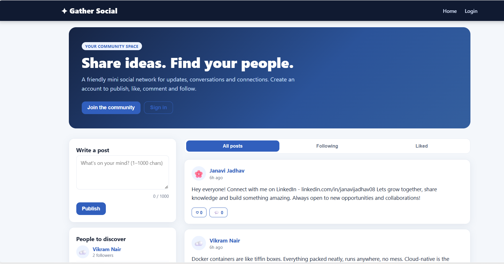
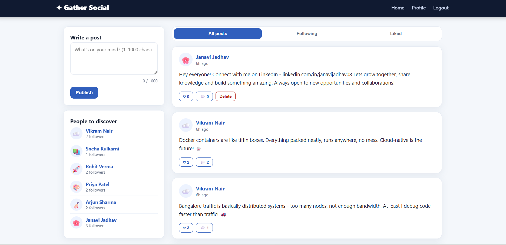

# ✦ Gather Social — CodeAlpha Social Media App

A full-stack social media web app built with **Node.js, Express, SQLite & Vanilla JS**  
📌 CodeAlpha Full Stack Development Internship Project

---

## 📸 Screenshots

### 🏠 Home Feed


### 👤 Profile Page


---

## ✨ Features

- 🔐 User Registration & Login (JWT Authentication)
- 📝 Create & Delete Posts (up to 1000 characters)
- ❤️ Like / Unlike Posts
- 💬 Comments on Posts
- 👤 User Profiles with Bio & Avatar Emoji
- ➕ Follow / Unfollow Users
- 📑 Feed Tabs — All Posts / Following / Liked
- 🔍 People to Discover Sidebar

---

## 🛠️ Tech Stack

| Layer | Technology |
|---|---|
| Backend | Node.js + Express |
| Database | SQLite (sqlite3) |
| Auth | JWT + bcryptjs |
| Frontend | HTML + CSS + Vanilla JavaScript |

---

## 🚀 Run Locally

```bash
# 1. Clone the repo
git clone https://github.com/janavijadhav08/CodeAlpha_SocialMedia.git
cd CodeAlpha_SocialMedia

# 2. Install dependencies
npm install

# 3. Setup environment
cp .env.example .env

# 4. Start the server
npm start
```

Open **http://localhost:3000** in your browser.

---

## 📁 Project Structure

```
CodeAlpha_SocialMedia/
├── server.js          ← Express API + SQLite setup
├── public/
│   ├── index.html     ← Single-page frontend
│   ├── app.js         ← All frontend JS logic
│   └── style.css      ← Styling
├── screenshots/       ← App screenshots
├── .env.example       ← Environment variable template
└── package.json
```

---

## 👩‍💻 Developed By

**Janavi Jadhav**  
🔗 [LinkedIn](https://linkedin.com/in/janavijadhav08) · [GitHub](https://github.com/janavijadhav08)

---

> 📌 *This is an educational MVP built for the CodeAlpha Full Stack Development Internship.*
